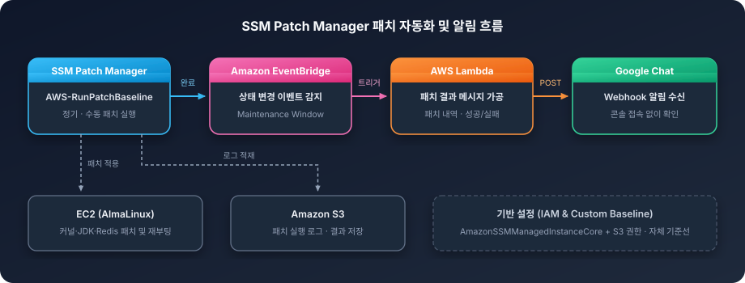

# {{ $frontmatter.title }}

최근 주요 보안 취약점이 연달아 공개되고 있다.

- [리눅스 커널 TCP 원격 코드 실행 취약점](/posts/linux-kernel-tcp) (`CVE-2026-98432`)
- OpenJDK 원격 코드 실행 취약점 [Java4Shell](https://news.hada.io/topic?id=37370) (`CVE-2026-114938`)
- NGINX에서 커널 권한 상승까지 이어지는 [NGINX2Root](https://news.hada.io/topic?id=37417)

이제는 애플리케이션을 넘어 웹 서버·런타임·OS 커널까지 전담 인프라 담당자 없이는 제때 대응하기 버겁다.

이에 따라 그동안 미뤄 두었던 고객사 EC2 테스트 환경의 커널 패치도 자동 관리하기로 했다.

## 최근 AlmaLinux 주요 커널 CVE 현황

[AlmaLinux 보안 페이지](https://almalinux.org/security/)를 보면, 알게 모르게 최근 몇 주 사이에도 치명적(Critical)이거나 중요(Important) 등급의 리눅스 커널 패치가 연이어 올라와 있었다.

| CVE 번호 | 심각도 | 주요 영향 및 내용 |
| --- | --- | --- |
| [`CVE-2026-99999`](https://almalinux.org/blog/2026-10-16-pwnescape-cve-2026-99999/) (PwnEscape) | Critical (9.3) | `virtio-net`/TAP 체크섬 오프로드 처리 결함으로 게스트-호스트 VM 탈출 및 원격 코드 실행 위험 |
| [`CVE-2026-98432`](https://almalinux.org/blog/2026-10-30-cve-2026-98432/) | Critical (9.8) | IPv4 TCP 연결 처리 중 Use-After-Free (원격 코드 실행·커널 패닉 위험) |
| [`CVE-2026-98276`](https://almalinux.org/blog/2026-11-06-cve-2026-98276/) | High (7.8) | `sock_gettstamp()`와 UDP `bind()` 경합으로 인한 Use-After-Free (로컬 권한 상승·커널 패닉) |
| [`CVE-2026-99288`](https://almalinux.org/blog/2026-11-16-noisytcp-cve-2026-99288/) (NoisyTCP) | Important (7.5) | TCP 소켓 조회(`ehash`) 경합으로 인한 NULL 포인터 역참조 및 원격 커널 패닉 |

원래 테스트 서버는 고객사 요청이 있을 때 운영 환경보다 먼저 업데이트를 시도해 보려고 만들어 둔 환경이라, 별도 요청이 없다면 대응하지 않고 있었다. 하지만 최근 리눅스 커널 취약점이 잇따라 공개되는데도 고객사에서 연락이 없는 걸 보면, 고객사 측에서도 인프라 관리를 제대로 챙기지 못하는 듯하다.

이제는 고객사 요청이 없더라도 테스트 서버 역시 운영 환경과 같은 수준으로 미리 커널 패치를 챙겨 두어야 한다.

## 일반적인 수동 커널 패치 명령어

원래는 EC2 인스턴스에 직접 접속해서 `dnf` 명령어로 커널을 업데이트하고 재부팅한다.

```bash [AlmaLinux 커널 수동 패치 및 확인]
# 1. 현재 실행 중인 커널 버전 확인
uname -r

# 2. DNF 메타데이터 캐시 초기화 및 커널 패키지 업그레이드
sudo dnf clean metadata
sudo dnf upgrade -y kernel

# 3. 재부팅 필요 여부 확인 (dnf-utils 설치 시)
sudo needs-restarting -r

# 4. 새 커널 반영을 위한 서버 재부팅
sudo reboot
```

재부팅이 끝나면 다시 `uname -r` 명령어로 올라간 커널 버전을 확인한다.

## Kernel Live Patching on AL2023

AL2023 문서를 찾아보다 새로 알게 된 사실인데, 조직 표준인 Amazon Linux 2023(AL2023)은 추가 비용 없이 [Kernel Live Patching](https://docs.aws.amazon.com/linux/al2023/ug/live-patching.html)을 지원한다. DNF나 SSM으로 `kernel-livepatch` RPM 패키지를 배포하면 서버를 재부팅하지 않고도 실행 중인 커널에 주요 CVE 패치를 적용할 수 있다. 다만 커널 버전마다 릴리즈 후 3개월까지만 라이브 패치가 제공되므로, 그 이후에는 커널을 직접 업그레이드해야 한다.

반면 고객사 환경의 AlmaLinux 같은 구독형(AWS Marketplace) AMI는 SSM Patch Manager에서 커널 라이브 패칭을 기본 지원하지 않는다. 새 커널을 설치해도 디스크에만 저장되므로, 실행 중인 커널에 패치를 반영하려면 **서버 재부팅** 이 필수다.

## SSM Patch Manager로 정기 패치 자동화

최근 인프라 설정을 따로 검토하지 않고 있었는데, AWS SSM 기능 중에 Patch Manager가 눈에 들어왔다. EC2에 `amazon-ssm-agent`와 IAM 역할을 연결해 Patch Manager로 패치와 재부팅을 일괄 관리하기로 했다.

### AmazonSSMManagedInstanceCore

SSM Patch Manager를 사용하려면 인스턴스 프로파일에 `AmazonSSMManagedInstanceCore` 정책이 필요하다. 기존 조직에서 쓰던 `AmazonEC2RoleforSSM`은 AWS가 지원을 중단한 오래된 정책이므로 이번 작업과 함께 새로운 정책으로 전환한다. 다만 `AmazonSSMManagedInstanceCore`에는 일반 S3 접근 권한이 빠져 있다. 패치 실행 로그나 결과를 S3 버킷에 저장하려면, 인스턴스 역할에 대상 S3 버킷에 대한 읽기·쓰기(`s3:GetObject`, `s3:PutObject` 등) 권한을 별도로 추가해야 한다.

::: tip Agent Toolkit for AWS
회사 맥북 장비에는 이미 [Agent Toolkit for AWS](https://github.com/aws/agent-toolkit-for-aws)([설치 안내](https://raw.githubusercontent.com/aws/agent-toolkit-for-aws/refs/heads/main/setup-instructions/setup.md))가 설치되어 있어요. AI 코딩 에이전트에 AWS MCP 서버와 스킬이 연동되어 있으니, 에이전트가 현재 AWS 환경을 조회해 사전 조사를 수행하고 Patch Manager 도입 계획을 세운 뒤 IAM 정책, S3 버킷, 알림 설정까지 저 대신 알아서 처리해 줄 거예요.
:::

### 패치 베이스라인

AWS는 AlmaLinux용 기본 베이스라인 `AWS-AlmaLinuxDefaultPatchBaseline`을 제공한다. 하지만 테스트 서버에서 운영하는 JDK, Redis, Elasticsearch에 맞춰 승인 대기 기간(`ApproveAfterDays`)과 패키지 포함·제외 조건을 관리하기 위해 자체 기준선(Custom Patch Baseline)을 만들어 대상 서버 태그(예: `PatchGroup: customer-test`)에 연결하기로 했다.

Patch Manager는 커널뿐 아니라 `dnf` 저장소의 미들웨어·런타임 패키지도 함께 업데이트한다. 이에 따라 Elasticsearch는 내장 JDK 대신 시스템 JDK를 사용하도록 전환해 JDK 보안 패치까지 함께 관리하고, 취약점이 자주 보고되는 Redis 역시 패치 제외 대상에 넣지 않고 업데이트 범위에 포함했다.

### 유지 관리 기간

정기 패치는 유지 관리 기간(Maintenance Window)에 `AWS-RunPatchBaseline` 문서를 `Operation: Install`로 실행하도록 등록한다. AlmaLinux 커널 패치 반영에는 재부팅이 필요하므로 `RebootOption`은 기본값(`RebootIfNeeded`)을 유지한다.

### AWS-RunPatchBaseline

Patch Manager를 설정했다면 긴급 취약점 대응이나 동작 검증 시에도 직접 EC2 인스턴스에서 명령어를 실행하지 않고, SSM Run Command에서 `AWS-RunPatchBaseline`을 수동 실행한다.

```bash [AWS CLI로 AWS-RunPatchBaseline 수동 실행]
# 점검
aws ssm send-command --document-name "AWS-RunPatchBaseline" --targets "Key=InstanceIds,Values=i-0123456789abcdef0" --parameters "Operation=Scan"

# 설치 및 재부팅
aws ssm send-command --document-name "AWS-RunPatchBaseline" --targets "Key=InstanceIds,Values=i-0123456789abcdef0" --parameters "Operation=Install,RebootOption=RebootIfNeeded"
```

### Google Chat 웹훅



AI와 대화를 나누다 보니 정기 패치 내역을 매번 AWS 콘솔에 들어가 확인하는 것도 불편할 것 같다는 이야기가 나왔다. 패치 작업이 끝나면 EventBridge에서 SSM 상태 변경 이벤트를 받아 Lambda를 트리거하고, 적용된 패치 내역과 성공·실패 결과를 Google Chat 웹훅으로 받아보려고 한다.

월 예상 비용은 약 1달러...?

